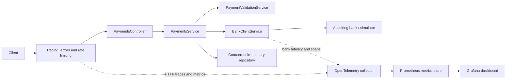

# Payment gateway

Requires the .NET 8 SDK pinned in global.json and Docker for the optional bank simulator.

## Run

```powershell
docker compose up --build -d --wait
Invoke-RestMethod http://localhost:15000/health/ready
pwsh -File scripts/smoke-test.ps1
dotnet test PaymentGateway.sln
```

The bank defaults to http://localhost:8080/. Override it using configuration key
Bank:BaseUrl (environment variable Bank__BaseUrl). The bank timeout is 10 seconds.
Tests use a controlled HTTP handler and do not require Docker.

See README.md for native SDK startup, port overrides and request examples.

## Architecture and implemented improvements



### Observability

Logs are JSON with trace/span scopes. Responses include `X-Trace-Id`, and problem
details include the same `traceId`. OpenTelemetry instruments incoming ASP.NET
requests, outgoing HttpClient requests and a `payment.process` application span.
Health requests are excluded from trace collection. The service name and custom
instrumentation source/meter name are `PaymentGateway.Api`.

| Instrument | Meaning |
| --- | --- |
| `payments.processed` | Counter tagged with authorized, declined, rejected or bank_failure outcome |
| `bank.authorization.duration` | Histogram of bank request duration in seconds, including failures |
| `payments.rate_limit.rejections` | Counter of requests rejected by throttling |

Labels are bounded: no payment IDs, card numbers, CVVs or authorization codes.
Application logging does not record request/response bodies or arbitrary
exception messages. The central error handler logs exception type and status;
the framework's duplicate raw exception logging is filtered. Tests capture logs
and check that submitted values do not leak. HTTP instrumentation supplies
standard server/client latency and request metrics.

OTLP export is enabled only when `OTEL_EXPORTER_OTLP_ENDPOINT` is configured.
Compose includes a collector that emits trace summaries to logs and exports
Prometheus metrics at localhost:9464/metrics. Prometheus normalizes instrument
names and units (dots become underscores; counters may gain `_total`). Compose
sets `OTEL_METRIC_EXPORT_INTERVAL=5000` milliseconds. Prometheus scrapes the
collector every five seconds and stores metrics for up to 24 hours with a 256 MB
retention cap. Grafana provisions the metrics data source and payment dashboard
from version-controlled files. Both use named volumes for local persistence.
The collector does not retain traces; trace summaries remain in console logs.

#### Telemetry endpoints

Start the stack with `docker compose up --build -d --wait`.

| Purpose | Endpoint / command | Access |
| --- | --- | --- |
| Inspect exported metrics | http://localhost:9464/metrics | Browser, curl or a Prometheus scraper on the host |
| View payment charts | http://localhost:15300/d/payment-gateway/payment-gateway | Grafana, local read-only anonymous access |
| Query stored metrics | http://localhost:9090 | Prometheus expression browser |
| Send traces and metrics to the collector | `http://otel-collector:4317` | OTLP over gRPC inside the Compose network; configured as `OTEL_EXPORTER_OTLP_ENDPOINT` on the API |
| Send telemetry from an IDE / host process | `http://localhost:4317` | Published on localhost; configured in the development launch profiles |
| Inspect trace summaries | `docker compose logs -f otel-collector` | Collector console output |

Port 4317 accepts telemetry over gRPC; it is not a browser page. Compose publishes
it on localhost for IDE/SDK development. The launch profiles set
`OTEL_EXPORTER_OTLP_ENDPOINT=http://localhost:4317` and a five-second export
interval. Restart an already running IDE process after changing its launch
settings. Host processes cannot use the Docker-only `otel-collector` hostname.

The metrics URL uses port 9464 by default. If `METRICS_PORT` is overridden, use
that host port instead. Make a payment request and allow about five seconds for
the Compose export interval before looking for custom payment metrics. There is
no trace-viewer endpoint in the current stack. Grafana visualizes metrics only.

Start the UI services with `docker compose up -d --wait prometheus grafana`.
The dashboard refreshes every five seconds and shows process counters, outcome
rates, bank/HTTP p95 latency, request rates and scrape health. Rates need at least
two scrapes; sparse traffic can leave latency panels empty. Ports are localhost
only and configurable with `GRAFANA_PORT` and `PROMETHEUS_PORT`. Viewing requires
no login. Local demo administration uses admin/local-demo-change-me; override
`GRAFANA_ADMIN_PASSWORD` before initializing the Grafana volume. Anonymous access
is a Viewer role, and signup is disabled. This local configuration needs separate
access controls before any external hosting.

An HTTP 200 response with an empty metrics body means the collector has not yet
received metrics. Check `docker compose ps`: the API must be running, not merely
Created. Start it with `docker compose up --build -d api`, or run the IDE profile
after starting the collector with `docker compose up -d otel-collector`. Send a
request to the API and wait for the export interval before refreshing `/metrics`.
Inspect exporter/collector errors with `docker compose logs api otel-collector`.

Compose publishes the API on port 15000 by default. If that port is occupied,
set `$env:API_PORT='15001'` in PowerShell before starting Compose and use the new
port in API/Swagger URLs. The metrics URL remains http://localhost:9464/metrics.
The collector has no application data to expose until an instrumented API
process exports measurements.

### Packaging and hosting

The multi-stage Dockerfile publishes using the serviced .NET 8 SDK and runs using
the ASP.NET 8 runtime as the non-root `app` user. `.dockerignore` excludes build
outputs, tests and source-control metadata. Compose starts the API, the unchanged
bank simulator and the telemetry collector. Published ports bind to localhost.

Simulator readiness is checked before API startup. The CI smoke job additionally
polls `/health/ready`: a running container is not proof of API readiness. Both
`/health/live` and `/health/ready` currently check application responsiveness.
They do not submit payments or call the bank, and are outside payment quotas.
An unavailable bank still permits retrieval of stored payments; these probes do
not guarantee that an authorization will succeed.

HTTPS redirection is enabled by default and explicitly disabled for the local
HTTP container. Forwarded headers run before rate limiting, trusting only the
framework's loopback defaults and explicitly configured proxy networks. Real
proxy deployments must also restrict direct access to the backend.

### API and code design

`ApiExceptionHandler` centralizes validation, bank and unexpected-error mappings.
Unexpected failures return generic 500 problem details; controllers focus on
successful responses. `ApiProblems` shares rejection response construction
between model binding and payment validation. Model-binding error keys are
restricted to known request fields, preventing submitted JSON property names
from appearing in errors. Every problem response carries a trace identifier.

Validation predicates are ordinary methods rather than stored delegate
properties. `PaymentValidationException` now uses its Exceptions namespace.
Existing service/bank boundaries remain; a repository interface is deferred
until another implementation or a concrete testing need justifies it.

## API

POST /api/payments with this JSON:

```json
{
  "cardNumber": "2222405343240001",
  "expiryMonth": 12,
  "expiryYear": 2030,
  "currency": "GBP",
  "amount": 100,
  "cvv": "012"
}
```

An authorized or declined payment returns 201 with its ID, status, last four card
digits, expiry, currency and amount. The Location header points to
GET /api/payments/{id}, which returns the same details. Unknown IDs return 404.

Invalid input returns 400 with paymentStatus "Rejected" and field errors. Rejected
requests do not call the bank and are not stored. Both malformed JSON and omitted
numeric fields are rejected.

Bank unavailability/network failure returns 503; timeout returns 504; unexpected
HTTP responses or malformed bank payloads return 502. These failures are not
declines and do not create stored payments. Caller cancellation is propagated.
An approval must include a nonblank bank authorization code; an approval without
one is treated as a malformed bank response (502). The code is not logged or
exposed in the public payment response.

The simulator in `imposters/bank_simulator.ejs` approves cards ending in an odd
digit, declines those ending in 2, 4, 6 or 8, and returns 503 for those ending in 0.
The bank client sends the request to the simulator rather than computing these
outcomes locally. Its request uses the simulator's snake_case field names and
formats the expiry date as MM/yyyy.

## Decisions and assumptions

### Endpoint rate limits

Payment endpoints use ASP.NET Core's fixed-window rate limiter, partitioned by
connection IP address and HTTP method. Defaults are 10 POST submissions and 60
GET lookups per 60-second window. Looking up different payment IDs shares the
same lookup quota. Requests are not queued; excess requests return HTTP 429 with
an `application/problem+json` body and a `Retry-After` header in seconds. Rejected
requests do not reach the controller or bank. Swagger documents the 429 response.

Configure `RateLimiting:Payments:SubmissionPermitLimit`, `LookupPermitLimit` and
`WindowSeconds` in appsettings.json, or set environment variables such as
`RateLimiting__Payments__SubmissionPermitLimit`. All values must be positive;
invalid values prevent application startup.

Counters are local to each API process and reset on restart. Clients sharing an
IP address share a quota. Forwarded headers are accepted only from loopback or
networks explicitly configured in `Hosting:KnownProxyNetworks` (environment
variable `Hosting__KnownProxyNetworks__0`). Without a trusted proxy configuration,
clients behind a proxy share its quota. Use an upstream shared limiter when
quotas must span instances. On .NET 8, Retry-After is a conservative window
estimate, typically 60 seconds, rather than a precise countdown. Rejections do
not restart the window.

### Payment processing

- Cards remain valid through the end of their expiry month, using UTC.
- Currency must be uppercase GBP, USD, or EUR.
- Amount is a positive 32-bit integer in minor currency units.
- Card numbers and CVVs accept ASCII digits only; no Luhn check is required.
- Card numbers, CVVs and last four digits are strings to preserve leading zeroes.
- The service validates before calling a typed HttpClient adapter. Only HTTP I/O
  is asynchronous; validation and in-memory repository operations are synchronous.
- A singleton concurrent dictionary stores immutable Payment objects, separate
  from the PaymentResponse API contract. The service maps stored payments to
  responses. Full card
  numbers and CVVs are sent to the bank but never persisted or returned.
- Storage is local to the running process and is lost on restart.
- There are no automatic payment retries: a failed response can leave the bank
  outcome unknown, and retries require an idempotency contract.
- Authentication, merchant isolation, durable reconciliation and idempotency are
  outside this assessment's implementation.

## Verification

The GitHub Actions workflow in `.github/workflows/ci.yml` runs on pushes to main,
pull requests, manual dispatch and Mondays at 07:00 UTC. One .NET job restores
and audits direct/transitive dependencies once, builds once with compiler and
analyzer warnings as errors, then runs tests against that build with coverage.
The container smoke test remains a separate job. The separate `.github/workflows/codeql.yml`
workflow scans C# with CodeQL's security-extended suite on the same triggers.
The .NET job enables build-time code style diagnostics; it does not enforce
whitespace formatting. Test results and coverage are retained for 14 days.

The dependency audit fails on known vulnerabilities of any severity or failure
to retrieve vulnerability information. Swashbuckle.AspNetCore 6.9.0,
Microsoft.NET.Test.Sdk 17.11.1, xunit 2.9.3 and its Visual Studio runner 2.8.2
resolve the previously reported Swagger UI and transitive test dependency
vulnerabilities. The full dependency audit passed after these updates.
CodeQL publishes findings to GitHub code
scanning; findings do not automatically fail the analysis job. Configure required
checks and code scanning merge protection in repository settings to enforce
merge restrictions. CodeQL is available for public repositories; private
repositories require GitHub Code Security.

Unit tests cover validation boundaries, bank decisions, rejection before bank
invocation, request mapping, malformed bank responses, transport failures and
cancellation. API integration tests exercise the real service, validator,
repository and HTTP bank adapter, including POST followed by GET, masking,
unknown IDs, invalid input and bank unavailability.

Additional tests verify error trace correlation, sensitive-data suppression in
responses and captured logs, generic unexpected-error handling, lightweight
health checks, concurrent throttling, rejection before bank calls and allowance
replenishment. The framework limiter uses a real short timer for the reset test;
it does not accept the application's TimeProvider.

CI also builds the Docker stack and runs `scripts/smoke-test.ps1` against the real
bank simulator. This covers approval, decline, retrieval, masking, validation,
trace correlation and bank unavailability, and always stops the stack afterward.
The simulator configuration remains unchanged.

## Future improvements

1. **Durable storage and reconciliation:** persist payment attempts/outcomes in
   a database with schema migrations; model pending/unknown outcomes and reconcile
   bank authorizations whose responses were lost. Resolve persistence before
   introducing multiple API instances.
2. **Idempotency:** define key scope, payload matching, concurrent duplicates,
   expiry and replay behavior. Coordinate with the bank's idempotency contract
   before adding retries; gateway-only keys cannot guarantee bank side-effect safety.
3. **Authentication and merchant isolation:** authenticate callers and authorize
   lookups against payment ownership; introduce appropriate secrets management.
4. **AWS deployment with Terraform and GitHub Actions:** provision ECR, ECS
   Fargate, networking, an HTTPS load balancer with ACM, CloudWatch logs/alarms
   and scoped IAM roles. Use encrypted/versioned remote Terraform state with
   locking, GitHub OIDC, reviewed plans and protected deployment environments.
   Build, scan and publish immutable image digests, deploy only after CI passes,
   verify health and support rollback. Include cost estimates and teardown
   instructions. This is a future proposal: no AWS resources, Terraform scripts
   or deployment workflows are included in this implementation.
5. **Operational monitoring:** retain distributed traces alongside the existing
   local metrics dashboard, add alerts for bank latency/errors and rejection spikes, and
   define service-level objectives, sampling and telemetry retention policies.
6. **Shared throttling and load testing:** enforce quotas across instances with
   an upstream/shared limiter; measure burst behavior and choose limits using
   realistic traffic, while preserving client-IP trust boundaries.
7. **Delivery hardening:** pin container/action versions to reviewed digests,
   automate updates, scan images, generate SBOMs, and test graceful shutdown and
   cancellation against slow real HTTP responses.
